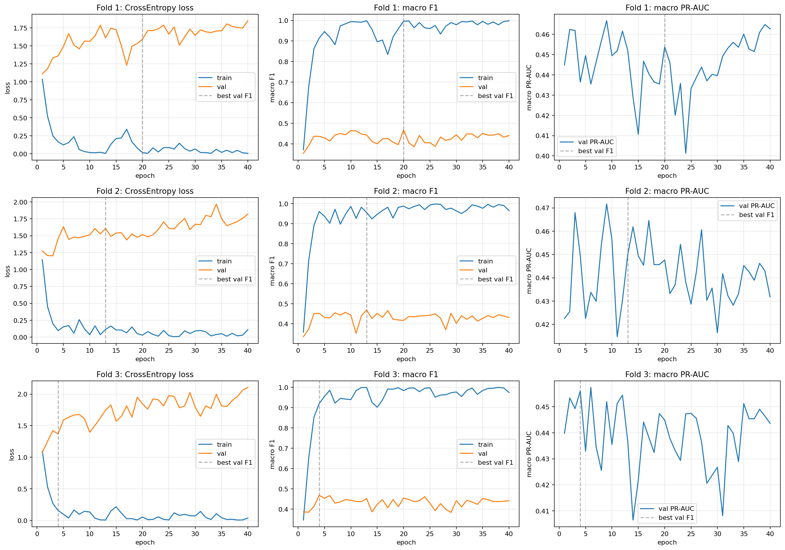
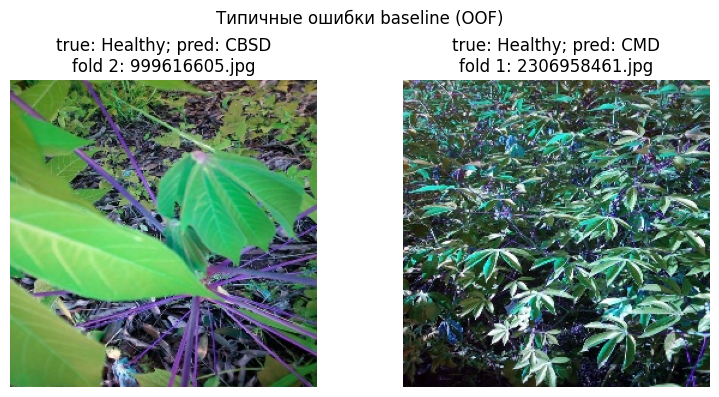

# ДЗ1, проект "Cassava Leaf Disease Classification"
## Логинов Никита

**Ноутбук, который я прогонял, лежит в hw_1/notebooks/model-notebook-original.ipynb. Можно посмотреть его**

### 1. Постановка задачи


По фотографии листа растения(Cassava) предсказываем заболевание либо здоровое состояние.

Это задача многоклассовой классификации, классов всего 5(0-4).

На момент предсказания нам доступна фотография растения.

Практический смысл: 
Автоматизированное распознавание состояния растения. В перспективе фермеры смогут предварительно определять заболевания по фотографии с мобильного устройства.

Ограничения: 
Модель должна быть легковесной, если в дальнейшем использовать ее на телефонах. Скорость и качество работы на телефоне пока не проверялись.
Дисбаланс классов
Качество фотографий

Гипотеза:
Если вместо предсказания самого частого класса использовать pretrained ResNet-18, macro F1 вырастет, так как сверточные слои извлекают признаки листа, по которым можно отличать заболевания.

### 2. Формализация задачи


X — фотография \
y — номер класса \
тип задачи - multiclass \
единица наблюдения - image \
что считается одним предсказанием - класс, который охарактеризовывает либо тип заболевания, либо здоровое растение \
на inference доступна только фотография; image_id и метки классов не используются как признаки \
классы: 0 - CBB, 1 - CBSD, 2 - CGM, 3 - CMD, 4 - Healthy

### 3. Данные (EDA)
источник данных - датасет на kaggle \
размер данных - 5000 изображений. В ней CBB - 254, CBSD - 511, CGM - 558, CMD - 3075, Healthy - 602.

Пропусков в image_id/label и повторяющихся image_id нет, все изображения из CSV найдены

потенциальные источники шума в разметке: некачественная фотография, неправильно определенный класс \
потенциальные источники leakage (лики):

1. Одно и то же фото в train и val. 
2. Фотографии одного растения могут попасть в разные части выборки; групп растений в CSV нет.
3. Обучение препроцессинга на val. В baseline статистики нормализации взяты из ImageNet, по val ничего не обучается.

Отдельный риск: модель может запомнить фон вместо признаков заболевания.

### 4. Baseline

Выбрал pretrained ResNet-18, потому что она легковесная, уже обучалась на ImageNet, поэтому имеет определенные знания о мире, что лучше, чем случайная инициализация. В своей архитектуре она использует сверточные нейронные сети, которые помогают извлекать информацию из изображений. Модели данного семейства часто используют для сравнения на разных бенчмарках.

Baseline простой: одна модель без ансамбля и аугментаций, обычный CrossEntropyLoss. Заморожены первые 70% тензоров параметров, а не ровно 70% скалярных весов; статистики BatchNorm обновляются в train.

Preprocessing: RGB, resize до 128х128, ToTensor, нормализация по ImageNet mean/std

SEED, SIZE, BATCH, EPOCHS, LR = 18, 128, 128, 40, 1e-3
MEAN, STD = (0.485, 0.456, 0.406), (0.229, 0.224, 0.225)

Оптимизатор - AdamW, weight_decay=0.01. Конфиг - configs/baseline.yaml.


### 5. Протокол оценки

Основная метрика: macro F1 на локальной валидации.

Почему: 5 классов, сильный дисбаланс (CMD сильно больше). Accuracy и micro F1 в основном отражают CMD; macro F1 одинаково учитывает все классы - это нам и нужно.

Сплит: StratifiedKFold(3, shuffle=True, random_state=18) на подвыборке 5000 изображений для оценки разброса между фолдами. В каждом фолде новая модель и оптимизатор.

Почему корректен: стратификация сохраняет доли классов. Но она не исключает попадание похожих фото одного растения в разные фолды.

Утечки описал в пункте 3)

Доп. метрики: macro precision, macro recall, macro average precision (в коде pr_auc_macro); отдельно для каждого класса precision/recall/F1 + support

Лучшая модель: эпоха с максимальным val macro F1 отдельно в каждом фолде. В исходном ноутбуке веса сохранялись в checkpoints/resnet18_fold_*_best.pt, но в переданных файлах этих чекпойнтов нет. baseline_model.pt сохранен отдельно в artifacts/legacy: у него нет метаданных, связь с текущими фолдами неизвестна.


### 6. Результаты baseline
3-fold F1 macro: 0.4684 ± 0.0007

Это среднее и выборочное std (ddof=1) по reports/fold_metrics.csv. Обучение при оформлении проекта не перезапускалось.

| Фолд | Лучшая эпоха | Macro F1 |
|---|---:|---:|
| 1 | 20 | 0.4681 |
| 2 | 13 | 0.4692 |
| 3 | 4 | 0.4679 |

Кратко по классам из сохраненного OOF-вывода ноутбука: CMD F1 ~0.85; CBB ~0.39; CGM ~0.28; CBSD ~0.44; Healthy ~0.39.
Лучший F1 у CMD; большое число примеров этого класса могло помочь обучению, но по одним метрикам причину не установить.

Графики обучения:




Типичные ошибки:

Вместо того, чтобы классифицировать растение как здоровое, модель помечает его как болезненное. Возможно, это вызвано тем, что на картинках здорового растения видны затемненные участки, что похоже на заболевание.




Гипотеза по исправлению ситуации: если добавить в тренировочную выборку более разнообразный набор картинок здорового растения при помощи аугментаций(например: применять цветокоррекцию), модель будет меньше обращать внимание на простые признаки, такие как затемнения на листьях, из-за чего ожидается улучшение precision, recall и, соответственно, f1


### 7. Выводы

Что получилось: простой baseline даёт macro F1 ~0.468 на val по трем фолдам.

Где слаб: редкие и путающиеся классы (CBB, CGM), смещен к CMD из-за дисбаланса и похожих симптомов на фото.

Следующие гипотезы: отдельно проверить взвешенный лосс по классам и аугментации. Ожидаю улучшение F1 редких классов и Healthy, соответственно, поднятие macro F1.

Ограничения результата: подвыборка 5000 изображений, один seed, нет независимого test и проверки групповых дубликатов.


### 8. Исследовательские вопросы

1. Вырастут ли macro F1 и recall CBB/CGM, если добавить веса классов в CrossEntropy, рассчитанные только по train каждого фолда?
2. Вырастут ли F1 Healthy и macro F1 при легкой цветокоррекции только train?

### 9. Запуск

Из папки hw_1:

```bash
python3 -m venv .venv
source .venv/bin/activate
python -m pip install -r requirements.txt
python src/train.py --check-data
bash scripts/run_baseline.sh
```

Обучение и оценка - src/train.py и src/evaluate.py, настройки - configs/baseline.yaml. Новые результаты сохраняются в runs/baseline; непустая папка не перезаписывается.

Изображения подключены через data/cassava_train к соседней папке cassava_train. На другом компьютере нужно указать свой image_dir в конфиге. Для первого обучения нужны интернет или скачанные веса ImageNet. Исходный notebook сохранен в notebooks/model-notebook-original.ipynb.