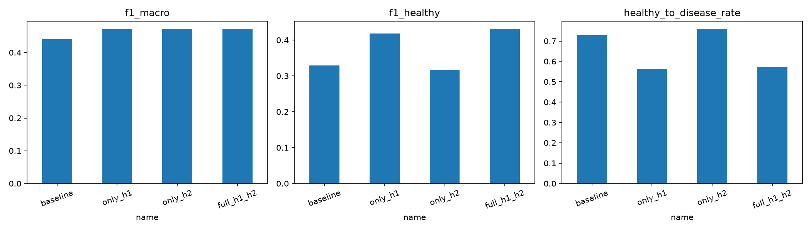
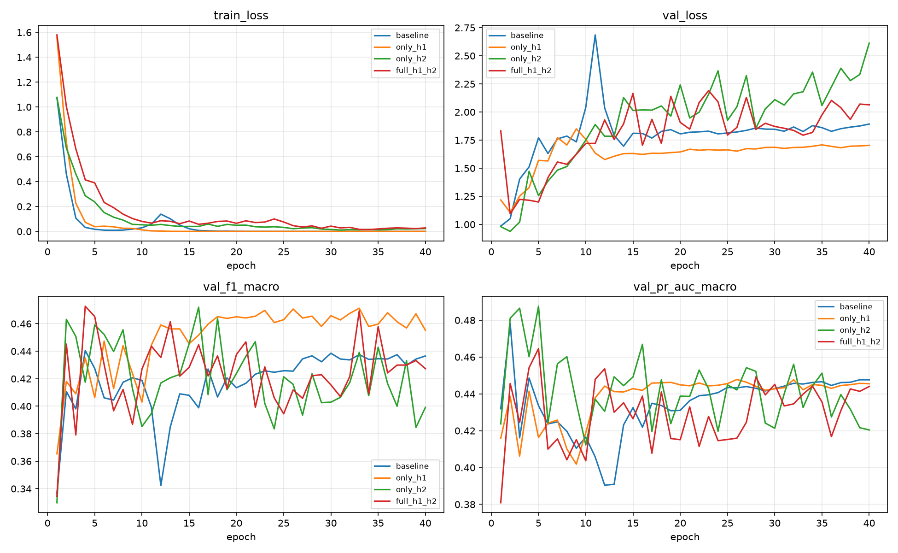
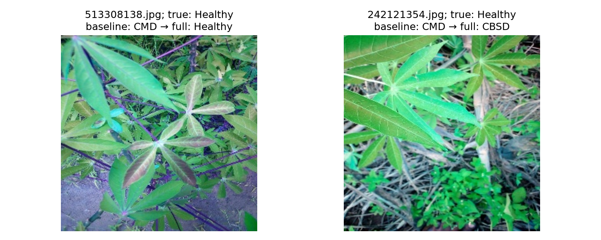

# ДЗ2 — Cassava: веса классов и аугментации
Логинов Никита

### 1. Что проверяем

В ДЗ1 модель хуже распознавала редкие классы и путала здоровые листья с больными.
Проверяем два изменения:

- H1 — веса классов в CrossEntropy. Редкие классы сильнее влияют на loss; ожидаем рост macro F1 и качества CBB/CGM. Как считать веса: `N_train / (5 × n_class)`, только по train.
- H2 — аугментации. RandomHorizontalFlip(0.5) и ColorJitter(0.2, 0.2, 0.2, 0.05) в train. Ожидаем рост F1 Healthy и macro F1, если модель станет меньше зависеть от освещения.


### 2. Условия эксперимента

Baseline из ДЗ1: ResNet-18 ImageNet, новая голова на 5 классов, resize 128×128,
ImageNet normalization. Заморожены первые 70% тензоров параметров; BatchNorm
обновляет статистики в train. AdamW: `lr=0.001`, `weight_decay=0.01`, batch 128, 40 эпох.


### 3. Результаты

Один запуск каждого варианта, seed=18. Полные метрики, параметры и гипотезы —
в [таблице экспериментов](reports/experiments_hw2.csv).

| Вариант | Веса | Aug | Лучшая эпоха | Macro F1 | Δ к baseline | F1 Healthy | Healthy → болезнь |
|---|:---:|:---:|---:|---:|---:|---:|---:|
| baseline | − | − | 4 | 0.4405 | — | 0.3291 | 72.9% |
| only_h1 | + | − | 33 | 0.4712 | +0.0308 | 0.4179 | 56.2% |
| only_h2 | − | + | 16 | 0.4720 | +0.0315 | 0.3172 | 76.0% |
| full_h1_h2 | + | + | 4 | 0.4727 | +0.0322 | 0.4316 | 57.3% |

**H1:** macro F1 вырос. F1 CBB: 0.4103 → 0.4286, Healthy: 0.3291 → 0.4179.
Но CGM ухудшился: 0.3293 → 0.2857. Веса помогли не всем редким классам.

**H2:** macro F1 вырос, особенно F1 CBB: 0.4103 → 0.5122.
Ожидание по Healthy не подтвердилось: F1 снизился до 0.3172,
доля ошибок выросла до 76.0%. Этот набор аугментаций не решил проблему Healthy.

### 4. Абляции и вывод

- Убираем аугментации из полной модели: macro F1 0.4727 → 0.4712,
  F1 Healthy 0.4316 → 0.4179. Их добавка к весам невелика.
- Убираем веса: macro F1 0.4727 → 0.4720,
  F1 Healthy 0.4316 → 0.3172. Для Healthy веса полезнее этого набора аугментаций.

Полная модель дала лучший macro F1, но преимущества над одиночными вариантами —
всего 0.0015 и 0.0007. Без повторов по seed нельзя отличить их от шума.

### 5. Графики и примеры








`513308138.jpg`: baseline предсказал CMD, полная модель — Healthy.
`242121354.jpg`: baseline предсказал CMD, полная модель — CBSD; ошибка осталась.
Все примеры из общего val. [Матрицы ошибок](reports/figures/confusion_matrices.png),
CSV ошибок и метрики классов находятся в `reports/`.

### 6. Структура и запуск

```text
hw_2/
├── configs/baseline.yaml
├── src/{train,evaluate,utils}.py
├── scripts/run_experiments.sh
├── data/                  # фиксированный split и ссылка на изображения
├── reports/               # таблица, истории, предсказания, графики
├── checkpoints/           # четыре лучшие модели
└── notebooks/             # исходный notebook с outputs
```

```bash
cd hw_2
python3 -m venv .venv
source .venv/bin/activate
python -m pip install -r requirements.txt
python src/train.py --check-data
# Проверить сохранённые CSV и восстановить графики без обучения:
python src/evaluate.py
# Заново обучить все четыре варианта (4 × 40 эпох):
bash scripts/run_experiments.sh
```

Новые результаты пишутся в `runs/hw2`; непустая папка не перезаписывается.
Пути в конфиге считаются от корня проекта. Изображения подключены ссылкой
на соседнюю `cassava_train`; на другом компьютере укажите свой `image_dir`.
Первое обучение требует скачивания ImageNet-весов либо готового кэша.
Окружение исходного запуска: Python 3.13.16, torch 2.11.0+cu130,
torchvision 0.26.0+cu130, Tesla T4; остальные версии — в архивном config JSON.

